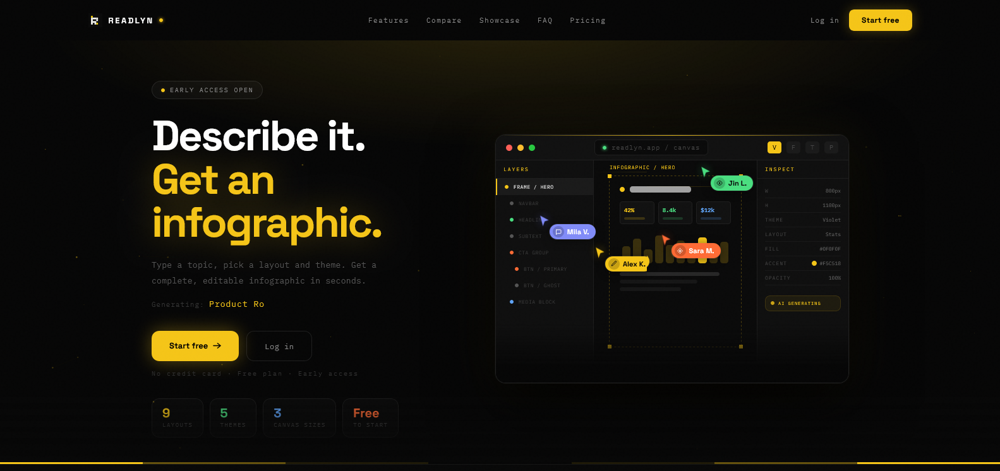

<div align="center">

  

# Readlyn

**Turn a prompt into a structured, editable infographic. Powered by Groq.**

[](https://readlyn.vercel.app)
[](https://github.com/MuhammadTanveerAbbas/Readlyn)
[](LICENSE)
[](https://typescriptlang.org)
[](https://nextjs.org)
[](https://supabase.com)
[](https://sdk.vercel.ai)
[](https://tailwindcss.com)
[](https://vitest.dev)

---

| 9 Layouts | 5 Themes | 4 Export Formats | Free to Start |
|:---------:|:--------:|:----------------:|:-------------:|
| Steps, Stats, Timeline, Compare, List, Pyramid, Funnel, Cycle, Auto | Ocean, Ember, Forest, Slate, Midnight | PNG, SVG, JSON, multi-size ZIP | No credit card during early access |

</div>

---

<div align="center">
  
</div>

---

## Overview

Readlyn turns a text prompt into a structured infographic. The server calls Groq through the Vercel AI SDK, validates the response against a Zod document schema, and streams elements onto a Fabric.js canvas. From there you can edit every element, import assets, and export the result.

The AI layer lives in `lib/ai/config.ts` and `lib/groq.ts`. Model IDs are checked against Groq's live catalog at runtime, with automatic fallback when a model is unavailable or rate limited. The default generation model is `openai/gpt-oss-120b`, and every task model can be overridden with an environment variable.

---

## Product Status (Early Access)

Readlyn is in early access. This README describes what the code does today.

- Every feature is unlocked for everyone during early access.
- There is no app-level generation cap. Groq's provider rate limits still apply.
- There is no billing integration. Pro and Team cards are placeholders, and choosing one changes nothing.
- Paid features are labelled "(coming soon)" in the pricing config and the UI.

### Not built yet

- Billing or Stripe integration
- Real time collaboration
- Team workspaces, roles, and permissions
- Figma import
- Custom font upload
- Named checkpoints
- Rulers, alignment guides, and multiple artboards
- Gradient, shadow, and blur controls in the inspector

---

## Features

### Generation

- **Prompt to document** Describe a topic, choose a layout and theme, and receive a validated infographic document with text, shapes, and line elements already positioned.
- **Streaming output** Elements appear on the canvas as the model produces them.
- **Runtime model discovery** `lib/groq.ts` reads Groq's model catalog, picks a working model for the task, and falls back automatically.
- **Task-based model config** General, design, code, analysis, edit, JSON, fast, and vision tasks each have their own default model and fallback chain.
- **9 layout archetypes** Steps, Stats, Timeline, Compare, List, Pyramid, Funnel, Cycle, and Auto, each with pre-computed element positions in `lib/archetypeLayouts.ts`.
- **5 color themes** Ocean, Ember, Forest, Slate, and Midnight.
- **3 canvas sizes** A4 portrait (800 x 1100), square (1080 x 1080), and wide (1920 x 600).

### Editor

- **Fabric.js canvas** Drag, resize, rotate, multi-select, group, ungroup, copy, paste, and edit text in place.
- **Layers panel** Visibility, lock, drag reorder, selection, and delete.
- **Properties inspector** Position, size, rotation, opacity, fill, stroke, stroke width, corner radius, font family, size, weight, alignment, line height, and letter spacing.
- **Undo and redo** A full canvas history with debounced snapshots.
- **Zoom and pan** Zoom slider, fit to screen, mouse wheel zoom toward the cursor, select tool, hand tool, and space-drag panning.
- **Command palette** Press `Ctrl+K` or `Cmd+K` to search and run editor commands.
- **Context menu** Right-click a selected element to duplicate, reorder, or delete it.
- **Snap to grid** Optional grid overlay and 20px movement snapping.
- **Keyboard shortcuts** Undo, redo, duplicate, delete, select all, copy, paste, group, ungroup, arrow nudge, tool switching, fit to screen, and `?` for the shortcut reference.
- **Auto Theme** Recolor the document from its current palette in one action.

### Import and export

- **PNG export** Rendered from the current canvas.
- **SVG export** Clean vector output for the current document.
- **JSON export and import** Round-trip the full document.
- **SVG and image import** Import an SVG, PNG, JPEG, or WebP file onto the canvas.
- **Multi-format ZIP** Renders A4, square, wide, story, and LinkedIn frames, and includes a React component generated from the canvas.
- **Developer Mode** CSS, React, SVG, and JSON output for any selected element.
- **Design tokens** W3C design token JSON for the current system.

### Workspace

- **Project dashboard** Create, open, pin, rename, and delete projects.
- **Generation history** Per-project snapshots with thumbnails, restore, and delete.
- **Brand kit** Saved locally and applied to the canvas.
- **Content check** Readability grade, text overflow detection, and a tone summary.
- **Autosave and offline buffer** Debounced saves to Supabase, with queued edits while offline.
- **Authentication** Email and password sign up, login, password reset, and protected routes through `proxy.ts`.
- **Settings** Account details and account deletion.
- **AI document API** Authenticated operations for create, update, delete, move, duplicate, restyle, inspect, and export.

---

## Design System

The interface is driven by CSS custom properties in `app/globals.css`. There is one source of truth for surfaces, type, spacing, radius, and motion.

- **Surfaces** `--surface-sunken` (#0b0b0c), `--surface-base` (#121214), `--surface-raised` (#191a1d), `--surface-overlay` (#212227), `--surface-inset` (#0e0e10).
- **Text** `--text-primary`, `--text-secondary`, `--text-body`, `--text-muted`, and `--text-faint` for a predictable hierarchy.
- **Accent** `--accent` (#f5c518) is reserved for primary actions, active states, and focus rings. `--accent-hover` handles pointer states.
- **Semantic colors** `--success`, `--warning`, `--danger`, `--info`, and `--orange`, each with a soft variant for tinted surfaces.
- **Type scale** Nine steps from 10px to 39px, with Bricolage Grotesque for headings and Figtree for body and UI text.
- **Canvas type** Bricolage Grotesque and Figtree are self-hosted webfonts because Fabric.js paints into a canvas element and cannot resolve CSS variables.
- **Spacing and radius** Fixed spacing steps (4 to 96px), radius steps (4 to 18px), and a full 9999px option.
- **Motion** Shared durations (120ms, 200ms, 350ms) and easing curves, with a reduced-motion override.
- **Noise and reveals** A subtle SVG noise overlay and a `useReveal()` intersection observer for section entrances.

---

## Tech Stack

| Category | Technology |
| --- | --- |
| Framework | Next.js 16, React 19, TypeScript |
| Styling | Tailwind CSS v4, Radix UI primitives |
| Canvas | Fabric.js v6 |
| AI | Groq via Vercel AI SDK v6, Zod-validated structured output, runtime model discovery and fallback |
| Auth and data | Supabase Auth, Postgres, and Storage |
| Validation | Zod schemas for documents, API requests, and route params |
| Sanitization | isomorphic-dompurify |
| Testing | Vitest |
| Fonts | Bricolage Grotesque for display and canvas headings, Figtree for body copy, UI and canvas text |
| Deployment | Vercel |

---

## Quick Start

### Prerequisites

- Node.js 18 or newer
- pnpm
- A Supabase project
- A Groq API key from [console.groq.com](https://console.groq.com/keys)

### Installation

```bash
git clone https://github.com/MuhammadTanveerAbbas/Readlyn.git
cd Readlyn
pnpm install
cp .env.example .env.local
# Fill in the values described below
pnpm dev
```

Open [http://localhost:3000](http://localhost:3000).

### Database

Run `supabase/schema.sql` in the Supabase SQL editor. It is idempotent and creates:

- `public.projects`
- `public.generation_history`
- `public.templates`
- `public.assets`
- `public.subscriptions` and `public.invoices` (reserved, no billing yet)
- Indexes for common lookups
- Row Level Security policies for every table
- The private `project-assets` storage bucket with user-scoped read, upload, and delete policies

---

## Environment Variables

```env
# Supabase
NEXT_PUBLIC_SUPABASE_URL=https://your-project-ref.supabase.co
NEXT_PUBLIC_SUPABASE_ANON_KEY=your-supabase-anon-key
SUPABASE_SERVICE_ROLE_KEY=your-service-role-key

# Groq
GROQ_API_KEY=your-groq-api-key

# App
NEXT_PUBLIC_APP_URL=http://localhost:3000

# Cron
CRON_SECRET=your-cron-secret

# Optional model overrides
# GROQ_MODEL_GENERAL=openai/gpt-oss-120b
# GROQ_MODEL_DESIGN=openai/gpt-oss-120b
# GROQ_MODEL_CODE=openai/gpt-oss-120b
# GROQ_MODEL_ANALYSIS=openai/gpt-oss-120b
# GROQ_MODEL_EDIT=openai/gpt-oss-120b
# GROQ_MODEL_JSON=openai/gpt-oss-120b
# GROQ_MODEL_FAST=openai/gpt-oss-20b
# GROQ_MODEL_VISION=qwen/qwen3.8-27b
```

`GROQ_API_KEY` and `SUPABASE_SERVICE_ROLE_KEY` are server-side only. The `NEXT_PUBLIC_` Supabase values are safe to expose to the browser.

---

## Project Structure

```
readlyn/
|-- app/
|   |-- (auth)/                  # Login, signup, password reset
|   |-- (protected)/             # Dashboard, editor, settings
|   |-- api/ai/document/         # Authenticated AI document operations
|   |-- api/generate/            # Streaming infographic generation
|   |-- api/export-multi/        # Multi-format ZIP export
|   |-- api/account/delete/      # Account deletion
|   |-- api/keep-alive/          # Cron keep-alive
|   |-- api/health/              # Health and model status
|   |-- privacy/                 # Privacy policy
|   |-- terms/                   # Terms of service
|   |-- globals.css              # Design tokens, base styles, motion
|   |-- layout.tsx
|-- components/
|   |-- app/                     # Editor UI, panels, modals, command palette
|   |-- landing/                 # Landing page sections
|   |-- legal/                   # Shared legal page shell
|   |-- ui/                      # Shared primitives
|-- config/
|   |-- plans.ts                 # Plan definitions
|-- hooks/
|   |-- use-canvas-history.ts    # Undo and redo history
|   |-- use-canvas-selection.ts  # Selection state and property updates
|   |-- use-offline-buffer.ts    # Offline edit queue
|   |-- use-reveal.ts            # Scroll reveal observer
|   |-- use-toast.ts             # Toast notifications
|-- lib/
|   |-- ai/config.ts             # Task model config and env overrides
|   |-- ai/document-tools.ts     # Validated document operations
|   |-- archetypeLayouts.ts      # Positions for every layout archetype
|   |-- canvas-fonts.ts          # Font preload for Fabric.js
|   |-- contentAwareness.ts      # Readability and overflow checks
|   |-- csrf.ts                  # Origin validation for API routes
|   |-- exportMultiFormat.ts     # ZIP export and frame transforms
|   |-- groq.ts                  # Model discovery, selection, fallback
|   |-- react-export.ts          # React component export
|   |-- renderElements.ts        # Fabric.js object factory and renderer
|   |-- sanitize.ts              # Prompt and output sanitization
|   |-- supabase/                # Browser, server, and proxy clients
|-- supabase/
|   |-- schema.sql               # Tables, indexes, RLS, storage policies
|-- e2e/                         # Playwright end-to-end specs
|-- tests/                       # Vitest unit tests
|-- types/
|   |-- infographic.ts           # Zod schemas and TypeScript types
|-- proxy.ts                     # Auth route protection
```

---

## Scripts

| Command | Description |
| --- | --- |
| `pnpm dev` | Start the development server |
| `pnpm build` | Production build |
| `pnpm start` | Start the production server |
| `pnpm lint` | Run ESLint |
| `pnpm typecheck` | Run TypeScript without emitting |
| `pnpm test` | Run Vitest unit tests |
| `pnpm test:watch` | Run Vitest in watch mode |
| `pnpm test:e2e` | Run the Playwright end-to-end specs |

The unit suite covers the infographic schema, layout positions, export transforms, document operations, plans, and security helpers. Playwright specs in `e2e/` cover the landing page, auth flows, API smoke checks, and responsive layouts.

---

## Security

- **CSRF origin checks** `/api/generate`, `/api/ai/document`, `/api/export-multi`, and `/api/account/delete` validate the request origin in `lib/csrf.ts`.
- **Server-side auth** The AI document route reads the Supabase session and rejects unauthenticated requests.
- **Row Level Security** Every table has RLS enabled with user-scoped policies. Storage policies restrict the `project-assets` bucket to the owner's folder.
- **Input sanitization** Prompt text is stripped of HTML and control characters, and generated output is sanitized with isomorphic-dompurify.
- **Route validation** Dynamic route segments are validated as UUIDs with `parseRouteId()`.
- **Provider limits** AI requests are subject to Groq's rate limits. Readlyn does not add a separate generation cap.

---

## AI Document API

`POST /api/ai/document` accepts a validated document and one operation:

| Operation | Payload |
| --- | --- |
| `inspect` | none |
| `export` | none |
| `create` | `element` |
| `update` | `id`, `patch` |
| `delete` | `id` |
| `move` | `id`, `x`, `y` |
| `duplicate` | `id` |
| `styles` | `id`, `styles` |

Requests require an authenticated Supabase session and a matching origin header. Operations are implemented in `lib/ai/document-tools.ts` and covered by unit tests.

---

## Deployment

Readlyn is built for Vercel.

1. Import the repository at [vercel.com/new](https://vercel.com/new).
2. Add `NEXT_PUBLIC_SUPABASE_URL`, `NEXT_PUBLIC_SUPABASE_ANON_KEY`, `SUPABASE_SERVICE_ROLE_KEY`, `GROQ_API_KEY`, `NEXT_PUBLIC_APP_URL`, and `CRON_SECRET`.
3. Run `supabase/schema.sql` against your production database.
4. Deploy.

The generate route uses streaming with a 60 second max duration.

---

## Roadmap

### Shipped

- [x] Streaming AI generation with Groq model discovery and fallback
- [x] Zod-validated structured document output
- [x] 9 layout archetypes and 5 color themes
- [x] 3 canvas sizes
- [x] Fabric.js editor with drag, resize, rotate, group, and text editing
- [x] Layers, inspector, undo and redo, zoom and pan
- [x] Command palette, context menu, and snap to grid
- [x] Keyboard shortcuts and clipboard actions
- [x] PNG, SVG, and JSON export
- [x] Multi-size ZIP export with a React component
- [x] JSON, SVG, and image import
- [x] Developer Mode with CSS, React, SVG, and JSON output
- [x] Design tokens and brand kit
- [x] Generation history with restore and delete
- [x] Content check for readability and overflow
- [x] Autosave and offline edit buffer
- [x] Supabase authentication and account deletion
- [x] CSRF checks, sanitization, and UUID validation
- [x] Row Level Security and storage policies
- [x] Health endpoint, sitemap, and robots

### Not shipped yet

- [ ] Billing and Stripe integration
- [ ] Real time collaboration
- [ ] Team workspaces, roles, and permissions
- [ ] Figma import
- [ ] Custom font upload
- [ ] Named checkpoints
- [ ] Rulers, alignment guides, and artboards
- [ ] Gradient, shadow, and blur inspector controls
- [ ] Dedicated mobile app

---

## Contributing

1. Fork the repository.
2. Create a feature branch.
3. Make the change and run `pnpm typecheck`, `pnpm lint`, and `pnpm test`.
4. Open a pull request with a short description of the change and how you verified it.

---

## License

MIT. See `LICENSE` for details.

---


## 👨‍💻 Built by Muhammad Tanveer Abbas

<div>

**Muhammad Tanveer Abbas**
Technical Product Partner for B2B SaaS & Internals Tools

[](https://x.com/m_tanveerabbas)
[](https://linkedin.com/in/muhammadtanveerabbas)
[](https://github.com/MuhammadTanveerAbbas)

If this project helped you, please consider giving it a ⭐
